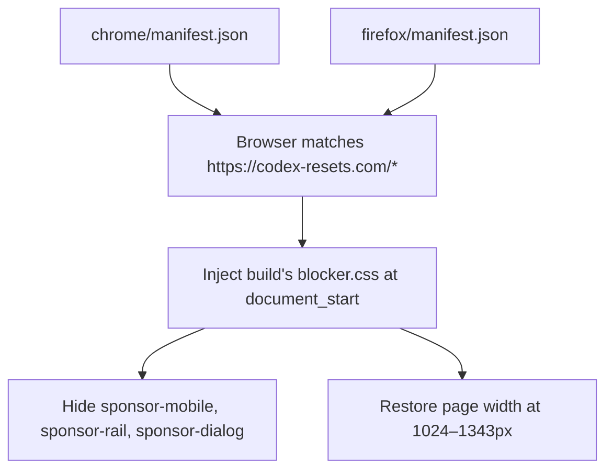
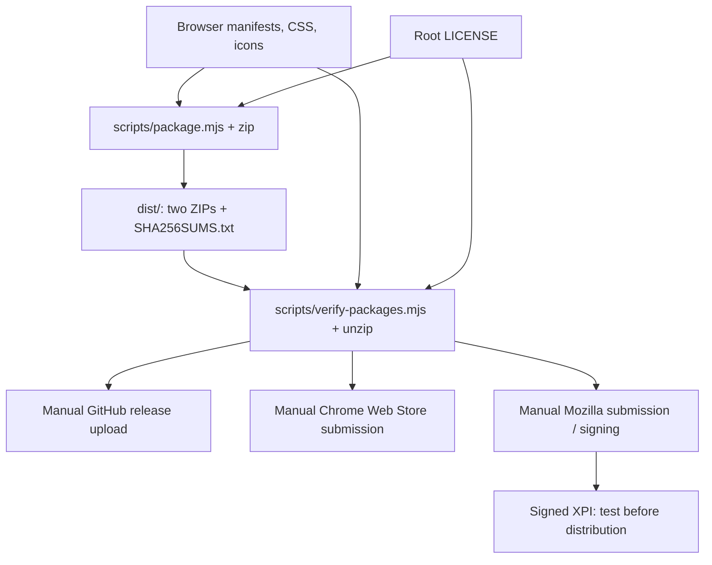

# Architecture

## Runtime: declarative CSS only

Each browser directory is a standalone Manifest V3 extension. Neither contains
JavaScript, a background worker, or a settings interface. Firefox additionally
declares its stable Gecko ID, minimum versions, and no data collection.

Each build has its own stylesheet and five PNG icons. Static tests require the
stylesheets to be byte-identical. Hiding uses `display: none !important`; the
width rule targets `.sponsor-layout > .page`. These rules change presentation,
not network traffic, DOM structure, or website JavaScript. New sponsor class
names will not be hidden automatically.

## Packaging flow

There is no compilation step. For each browser, `scripts/package.mjs` reads its
manifest version, creates a ZIP in a temporary directory, moves it into `dist/`,
and hashes the finished archive. Its explicit file list contains `manifest.json`,
`blocker.css`, icons at 16/32/48/96/128px, and root `LICENSE`. Documentation,
tests, and store artwork are not shipped. The manifest is at the archive root.

`scripts/verify-packages.mjs` checks the exact archive entry list and order,
compares every packaged byte with current source, and verifies the complete
checksum file. It checks existing archives, so package first after changes.
It does not prove browser behavior, store acceptance, or signing status.

## Verification boundaries

- `tests/static.test.mjs` checks manifest shape and the current release version,
  single-site content script, absence of the `permissions` field, icon
  dimensions/color type, CSS parity, Gecko metadata, and artwork dimensions.
- `tests/live-site.test.mjs` fetches the website with a 15-second timeout,
  requiring a successful HTTP response and five class names in its HTML. It
  does not execute website JavaScript, install the extension, or inspect styles.
- `npm run lint:firefox` runs external Mozilla `web-ext` lint through `npx`.
- `npm run release:check` runs static → live → lint → package → verify,
  stopping on the first failure.

Manually check packaged builds in both browsers at mobile and desktop widths.
No script publishes or signs artifacts; follow the
[release checklist](../store/README.md) for those external steps.
